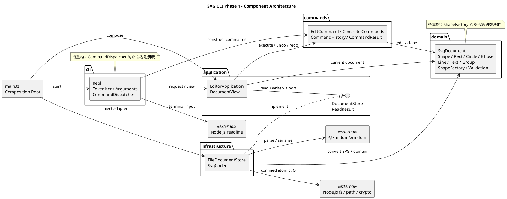

# Lab1 Phase 1：SVG CLI 编辑器

实现语言为 TypeScript，运行于项目内的 Node.js 24.22.1。项目面向课程中的单文档 SVG 命令行编辑任务。日常运行与命令示例见项目根目录 [README.md](../README.md)。

## 架构方案

### 模块职责与依赖

| 模块 | 主要职责 | 允许依赖 |
|---|---|---|
| `domain` | 图形几何、样式、ID 校验、文档树、父子关系和深拷贝 | 领域模块自身 |
| `commands` | 封装编辑动作，保存前后快照，管理 undo/redo | `domain` |
| `application` | 管理当前文档、默认文件路径、IO 历史边界和文本展示 | `commands`、`domain` |
| `cli` | 终端循环、分词、参数检查、命令分发和消息输出 | `application`、`commands`、Node `readline` |
| `infrastructure` | XML 编解码、文件读写、路径边界和原子保存 | `application` 中的接口、`domain`、XML 库及 Node 文件 API |

`src/main.ts` 是装配入口：构造文件存储适配器，将它注入应用，再把应用交给 CLI。它可以知道具体实现；领域层不接触终端、文件系统或 XML。`application/DocumentStore.ts` 定义读取、保存接口以及 `ReadResult`，应用只依赖接口，`FileDocumentStore` 实现接口，因此可以在测试中替换存储方式。

组件图源文件为 [architecture.puml](architecture.puml)，内容如下。实线箭头表示使用关系，虚线实现箭头表示适配器实现存储接口。



### 三个设计模式的具体落点

**Command（命令）**：每一种编辑有独立类，如 `MoveCommand`、`DeleteCommand`、`GroupCommand`。它们继承 `EditCommand`，通过 `apply(document)` 描述动作；统一的 `execute/undo/redo` 负责事务边界与恢复。`CommandHistory` 管理两个命令栈，应用无需按命令种类编写撤销逻辑。

**Composite（组合）**：`Rect`、`Circle`、`Ellipse`、`Line`、`Text` 和 `Group` 具有共同的 `Shape` 抽象。容器递归调用子图形的 `move/scale/clone`；调用者可以用同一接口操作单个图形或整个组。树展示与 SVG 导出也通过 `getAttributes/getChildren/getText` 遍历，不重复编写六套图形名称判断。

**Memento（备忘录）**：编辑命令保存操作前、后的完整文档快照。执行时先克隆当前文档，在副本上编辑，全部成功后才发布新文档并记录历史；撤销、重做分别恢复对应快照的副本。各个图形自行实现 `clone()`，保留子类行为，不使用 JSON 转换对象。快照是命令私有状态；成功执行过的命令实例不能再次作为新命令执行，以免覆盖已保存的历史。

例如 `move r1 10 20` 的路径是：分词 → 命令分发器创建 `MoveCommand` → 历史管理器执行命令 → 克隆并移动副本中的 `r1` → 应用接收新文档 → CLI 输出结果。若过程中 ID 无效或计算溢出，副本被丢弃，当前文档和 redo 保持原状。

完整快照便于保证整组编辑与删除的可逆性，但每个历史项都占用与文档规模相关的内存；文档操作中存在遍历和重复校验，大型文档下性能需要改进。本阶段按小型课程图形文档取舍，不声称所有操作为线性复杂度。

### 行为决策与接口约束

- `DocumentStore.read(path)` 返回 `{ document, warnings }`；`write(path, document)` 成功后才完成。读取先解析和验证全部内容，再替换当前文档；ID 补全警告仅在整体成功后输出。
- `init/read/save/canvas w h` 成功后清空并锁定历史，下一次成功编辑解锁。查看类命令不改变历史；失败的任何命令都不改变当前文档、默认保存路径或历史。
- 新文档默认 800 × 600；ID 全局唯一且区分大小写。数值必须有限，尺寸和半径允许零，画布尺寸与缩放因子必须为正。
- `group` 至少选择两个节点，按原树的深度优先遍历顺序组合；跨父容器时放在成员父容器的最近公共祖先下、最早受影响分支的位置。这是对题面未细化位置规则的明确选择。
- 禁止重复成员、祖先与后代同时分组、自身包含及容器循环。根级 `ungroup` 按题面规则拒绝；嵌套容器解组后，子节点在原位置提升。`addto` 追加到目标末尾。
- `front` 移到兄弟列表末尾，`back` 移到开头；这些顺序会保存在 SVG 中。组样式使用 SVG 继承语义，不覆盖子节点显式样式。
- 缩放围绕画布原点，同时乘以几何坐标与尺寸；描边宽度保持原值。字体设置不在本阶段属性白名单中。
- 路径以项目根目录为基准，检查词法路径与符号链接解析后的真实路径。保存用目标目录内临时文件写入、同步、关闭后替换目标；失败时清理临时文件，父目录需要预先存在。

SVG 导入只支持六种内置元素及规定属性。画布尺寸接受无单位数值或 `px`；图形几何属性只接受无单位数值。`viewBox` 缺省或与画布一致；不支持 `path/transform/style/font-size/font-family/tspan`、外部命名空间、DTD 和嵌套 `svg`。XML 的解析与转义交给 `@xmldom/xmldom`，解析警告也按错误处理，以免悄悄修复后丢失信息。这个基础 SVG 范围已作为当前实现选择记录；若教师要求任意外部 SVG 兼容性，需要继续扩展。

### 变化点与待重构位置

当前名称分派集中在两处，均标记为**待重构**：`cli/CommandDispatcher.ts` 的命令名注册表，以及 `domain/ShapeFactory.ts` 的图形名到构造类映射。SVG 导入与 CLI 创建共用后者，不再增加另一份图形分派表。未来插件阶段可将注册表提取为可注入扩展点，添加 `box` 等新图形时注册实现；本阶段没有提前伪造插件功能。

未来更换终端为图形界面可以复用应用、命令和领域层；更换存储方式可实现另一个 `DocumentStore`；大文档优化可增加 ID 索引，并评估增量快照或有界历史。支持 `transform`、任意 `viewBox` 或更多 SVG 元素需要同时扩展领域表达、导入校验与回归测试，不能只忽略未知属性。

## 过程记录

以下按实际开发顺序记录，不把未来计划写成已完成事项。

- 2026-10-27：用户确认 TypeScript 初学者、无额外依赖限制，SVG 仅支持基础六类与规定属性，复杂 SVG 明确拒绝。
- 2026-10-27：确认工作目录为空，PATH 中没有 Node/npm。开始准备项目内运行环境、严格类型检查、CLI 与测试骨架。
- 2026-10-27：Node 24.22.1 官方下载校验通过；沙箱 npm DNS 失败后通过获批的联网安装完成依赖。骨架 CLI 的 help/EOF 测试通过。
- 2026-10-27：实现六种多态图形、私有字段、深拷贝、公共祖先分组及循环检查。21 项领域测试通过；tree 展示采用题面 x/y/w/h 等格式，SVG 属性仍使用 width/height。
- 2026-10-27：用户明确截止日期为 10 月 31 日；具体截止时刻未提供。远程仓库地址待用户创建后提供。
- 2026-10-27：Command + Memento 在副本中执行再发布，补充 7 项命令/分词测试，验证失败不损坏 redo、IO 锁定、整组撤销和浮点溢出回滚。领域与命令合计 28 项测试通过。
- 2026-10-27：前三个开发阶段分别形成环境骨架、领域模型、命令与历史的本地提交，持续记录验证结果。
- 2026-10-27：完成 SVG 编解码与受限文件存储，验证缺失 ID 避让后续显式 ID、中文及 XML 转义、非法 SVG 拒绝、符号链接越界、原子保存失败清理。曾在测试夹具中加入不在白名单内的字体属性，核对范围后改为明确拒绝测试。
- 2026-10-27：复查发现 DOCTYPE 检查会误判注释和 CDATA 中的同名字面文本，调整预检查并加入回归测试；实际 DTD 仍被拒绝。
- 2026-10-27：CLI 验收发现初版遗漏 `create rect/circle/ellipse` 的可选填充色以及 `create line` 的可选描边色；修复参数解析，增加带颜色、缺省颜色、空颜色及多余参数的回归测试。
- 2026-10-27：复查发现重复执行同一个命令实例会覆盖历史快照；增加成功命令只能执行一次的保护，并加入撤销/重做回归测试。
- 2026-10-27：补充根目录使用说明、四部分课程文档和 PlantUML 组件图，整理运行环境、GitHub 建库及后续推送步骤。最终测试总数以 `npm test` 实际输出为准。
- 2026-10-27：复查发现 SVG 文本中的 `&#13;` 读回后保存为字面回车，再次读取会变成换行。将序列化中的回车输出为字符引用，新增往返一致性回归测试。
- 2026-10-27：最终 67 项测试全部通过，34 个 TypeScript 文件通过架构检查。交互式终端验证 `svg>`、编辑、撤销、属性查看及 Ctrl-D 正常；项目内环境脚本的 Bash/Zsh 使用和基于缓存的 `npm ci` 验证通过。
- 2026-10-27：浏览器工具策略拒绝直接打开本地 SVG，改用项目内的离线 resvg 渲染器验证 800×600 流程图；确认中文、两节点位置、颜色和连接线符合示例。渲染工具和图像只放在忽略目录，未加入运行依赖。
- 2026-10-27：用户提供交付仓库 `https://github.com/Suzuran-ll/svg-editor-lab1`。已确认远程为空，配置为 `origin`，准备推送完整分步历史和最终标签。

本地提交、最终标签状态以 `git log --oneline --decorate` 和 `git show final --stat` 为准。交付仓库为 [Suzuran-ll/svg-editor-lab1](https://github.com/Suzuran-ll/svg-editor-lab1)；使用 `git ls-remote origin refs/heads/main refs/tags/final 'refs/tags/final^{}'` 可核对远程分支与最终标签，在 **2026-10-31** 截止前确认两者可见。

## 一致性自查

| 检查项 | 实现对应与结论 |
|---|---|
| 模块与目录一致 | `src/domain`、`src/commands`、`src/application`、`src/cli`、`src/infrastructure` 对应组件图；`src/main.ts` 单独负责装配 |
| 类名与文件名一致 | 每个类单独放入同名 `.ts` 文件；`DocumentStore`、`CommandResult`、`Token` 等接口/类型文件不伪装成类 |
| 依赖方向一致 | 领域层不导入 IO；命令层只依赖领域；应用通过存储接口调用适配器；架构脚本检查越层与循环引用 |
| 数据封装 | ID、几何、样式和子节点由类维护；读取属性及数组返回防御性只读副本，通过方法执行变更 |
| 三个模式实际落地 | 命令子类和历史管理器、`Shape/Group` 组合结构、命令私有前后深快照均有实际调用和对应测试 |
| 两处名称分派 | 命令名在 `CommandDispatcher`，图形名在 `ShapeFactory`；展示、导出与变换使用多态，两个入口均记录为待重构 |
| CLI 功能 | 覆盖新建、读取、保存、画布、六类创建、移动、缩放、属性、删除、分组/解组、移入、层次顺序、查看、撤销/重做、帮助 |
| 历史规则 | 编辑成功才入栈；失败不破坏 redo；IO 成功清空并锁定；查询不改变历史 |
| SVG 与文件边界 | 显式重复 ID 拒绝、缺失 ID 延迟补全警告、未知能力明确报错；文件操作限制在项目根目录内 |
| 实际依赖 | 运行依赖 `@xmldom/xmldom` 0.9.12；开发依赖 TypeScript 7.0.2 与 `@types/node` 24.19.2；版本由 `package-lock.json` 固定 |
| 运行和产物 | Node 24.22.1 位于 `.tools/node`；npm 缓存位于 `.cache/npm`；测试临时产物位于 `.tmp`；编译输出位于 `dist` |
| 交付内容 | 源码、测试、样例、文档、环境脚本和锁文件提交 Git；工具、缓存、依赖目录及生成产物由 `.gitignore` 排除 |

`scripts/check-architecture.mjs` 是可重复执行的静态约束检查，不能代替人工评审；例如它不证明每一处业务语义正确，也不完整分析任意 TypeScript 表达式。模块职责、模式应用和 SVG 边界仍需结合源码与行为测试判断。

## 质量保证手段

### 可重复运行的检查

在项目根目录执行：

```sh
source scripts/env.sh
npm run build
npm test
npm run check:architecture
```

`build` 使用严格 TypeScript 配置，包括 `strict`、`noUncheckedIndexedAccess`、`noImplicitOverride` 和编译错误时不输出。`npm test` 编译后使用 Node 自带 `node:test`，避免额外测试框架；通过标准断言验证结果及错误后的状态。测试数量与最终通过情况**以 `npm test` 实际输出为准**。

### 有意义的测试场景

| 测试层 | 验证重点 |
|---|---|
| `domain.test.ts` | 六种图形、数值与白名单、可选颜色、封装与深拷贝、组递归移动/缩放、公共祖先分组、提升位置、循环和同层顺序 |
| `commands.test.ts` | 整组操作只占一个撤销单元、redo 清理规则、失败回滚、IO 历史锁定、快照隔离及同一命令实例不能重入历史 |
| `application.test.ts` | 存储失败时保留文档、历史与默认路径；成功读取及另存时更新路径 |
| `svg.test.ts` | 全类型往返、中文/空文字/XML 特殊字符、前向 ID 冲突、非法 XML 和不支持 SVG、viewBox、文件错误、路径及符号链接边界、失败临时文件清理 |
| `integration.test.ts` | 启动真实 CLI 子进程，回放命令并独立解析输出 SVG；检查文件、树结构、几何、顺序、错误输出与失败后的继续执行 |
| `bootstrap.test.ts` | 无文档帮助、启动和 EOF 行为 |
| 架构脚本 | 文件与类名、单文件单类、允许的模块/外部依赖、循环引用以及额外图形名称分派 |

关键失败场景比较失败前后状态，而不只检查“抛出错误”：例如在 `undo` 后执行非法编辑再 `redo`，验证历史仍有效；对部分子节点计算可能溢出的整组变换，验证当前文档没有被局部修改。保存失败测试还检查原有内容及临时文件清理，路径边界测试的夹具本身也只放在项目 `.tmp` 内。

### 场景回放与交付核验

```sh
npm run cli < examples/demo.commands
npm run cli < examples/flowchart.commands
```

两个脚本覆盖题面示例和两节点流程图；`demo.commands` 包含预期错误，需按注释判断，而不是把所有错误输出都视为故障。除了查看命令输出，还应打开 `.tmp/demo.svg`、`.tmp/flowchart.svg` 检查文字、节点位置、颜色和连接线，再验证读回后的结构与属性。

本次验收的 67 项测试全部通过，架构检查通过，并完成流程图离线渲染检查与交互终端检查。后续修改需重新运行上述检查，再核对文档、分阶段提交和 `final` 标签，完成分支和标签推送。截止日期为 2026-10-31，具体截止时刻仍待课程通知确认。
